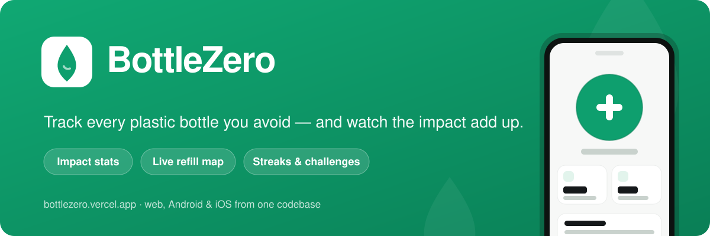
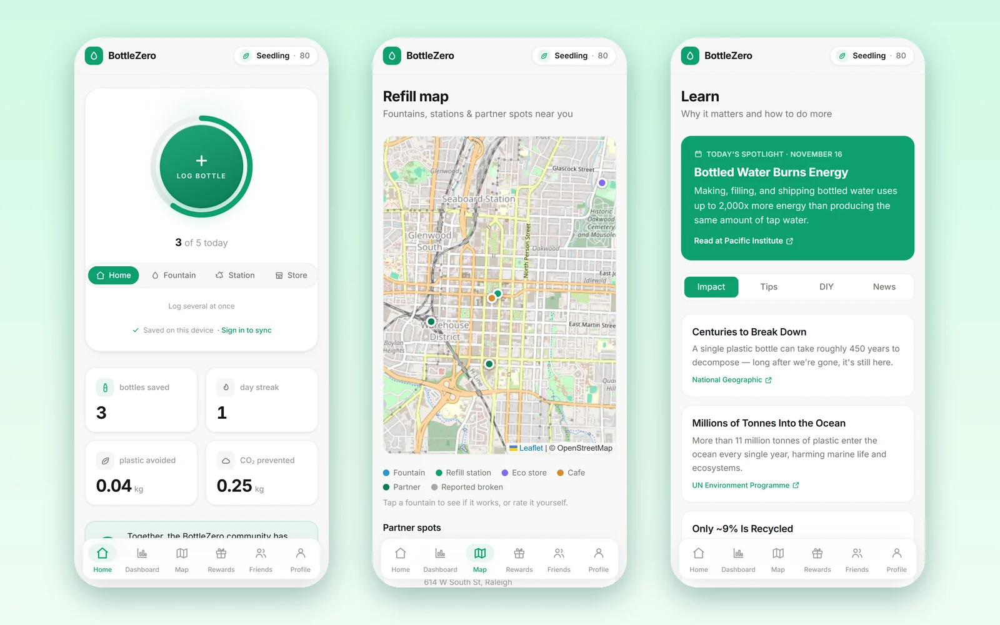

<p align="center">
  
</p>

# BottleZero 💧

<p>
  <a href="https://github.com/Ary5272/bottlezero/actions/workflows/ci.yml"></a>
  
  
  
  
  
  
</p>

BottleZero helps people cut down on single-use plastic bottles. Every time you refill a reusable bottle instead of buying a plastic one, you log it with one tap, and the app shows you the real impact: plastic kept out of landfills, CO₂ prevented, and money saved. A live map shows nearby water fountains and refill spots, and friend challenges turn it into a game.

- **Try it in your browser:** https://bottlezero.vercel.app (works on any phone or computer, and can be installed as an app)
- **Android:** [BottleZero on Google Play](https://play.google.com/store/apps/details?id=com.bottlezero.app)
- **Built for:** the Congressional App Challenge, as a solo student project

<p align="center">
  
</p>

## Why I built it

Plastic water bottles are one of the easiest kinds of waste to avoid, but most people don't notice how many they go through. Seeing a running total of bottles you didn't buy, and what that adds up to, makes refilling feel like it actually counts. BottleZero is built to make that one-tap habit easy, and to make it more fun with friends. Also I wanted people to know what impact they were having on the world and pollution is one of the main ways sadly

## What it does

- **Log a refill in one tap**, with where you refilled (home, fountain, refill station, or store), plus undo.
- **See your impact:** bottles saved, plastic avoided, CO₂ prevented, and money saved, with daily goals and streaks.
- **Find refills on a live map** of real drinking fountains from OpenStreetMap, plus refill stations and partner spots.
- **Rate fountains:** mark a fountain as working or broken, and whether you'd drink from it, so others know before they go.
- **Compete with friends** through join-code challenges and leaderboards, plus a community-wide counter.
- **Earn points, levels, badges, and perks** as you save more.
- **Learn** from short, sourced facts that rotate daily.
- **Share** your impact as a generated picture card.
- **Works offline**, with light and dark themes, an interactive walkthrough for new users, and optional daily reminders.
- **Your data, your call:** use it without an account (data stays on your device), or sign in to sync. You can export or delete your account from inside the app.

## Tech stack

| Part | What it uses |
|---|---|
| App | React 19, Vite, Tailwind CSS v4, React Router |
| Map | Leaflet + OpenStreetMap, live fountains from the Overpass API |
| Accounts and data | Supabase (Postgres, Auth, Row Level Security) |
| Impact equivalents | A Python serverless function on Vercel (`api/impact.py`) |
| Android app | Capacitor (the same React code, wrapped as a native app) |
| Tests and CI | Vitest, ESLint, GitHub Actions |

Everything runs on free tiers.

## Run it locally

You need [Node.js](https://nodejs.org) 20.19 or newer.

```bash
git clone https://github.com/Ary5272/bottlezero.git
cd bottlezero
npm install
npm run dev
```

Then open http://localhost:5173. That's it: without any setup, the app runs in device-only mode and saves everything in your browser.

Other commands:

```bash
npm test          # run the unit tests
npm run lint      # check the code with ESLint
npm run build     # production build into dist/
```

### Optional: accounts, challenges, and fountain ratings

These features need a free [Supabase](https://supabase.com) project:

1. Create a Supabase project.
2. In its **SQL Editor**, run these files from the `supabase/` folder in order: `schema.sql`, `community_stats.sql`, `security_hardening.sql`, `challenge_delete.sql`.
3. Under **Authentication → Providers → Email**, turn off "Confirm email" so new accounts work right away.
4. Copy `.env.example` to `.env` and fill in your project's URL and anon key:

```
VITE_SUPABASE_URL=https://<your-project>.supabase.co
VITE_SUPABASE_ANON_KEY=<your anon key>
```

The "real-world equivalents" card on the Dashboard comes from the Python function in `api/`, which runs on Vercel. When you run the app locally with `npm run dev`, that card just stays hidden.

## Project structure

```
src/
  routes/       one file per screen (Dashboard, Map, Rewards, Insights, Challenges, Learn, Profile, ...)
  components/   shared UI (log button, map, fountain ratings, onboarding, walkthrough, ...)
  state/        React context for app data, accounts, theme, reminders, and the walkthrough
  lib/          impact math, badges, streaks, ratings, Supabase client (with unit tests)
  data/         facts, seed refill locations, partner spots
api/            Python serverless function for impact equivalents
supabase/       database schema, security rules, and functions
android/        the Android app (Capacitor)
public/         PWA manifest, service worker, icons
scripts/        icon and image generators, iOS setup script
docs/           detailed docs and images
```

## More docs

- [docs/DETAILS.md](docs/DETAILS.md): full feature list, architecture, data model, impact sources, and security
- [docs/NATIVE.md](docs/NATIVE.md): how the Android and iOS apps are built from the same code
- [docs/ANDROID_BUILD.md](docs/ANDROID_BUILD.md): step-by-step Android build

## License
[MIT](LICENSE)